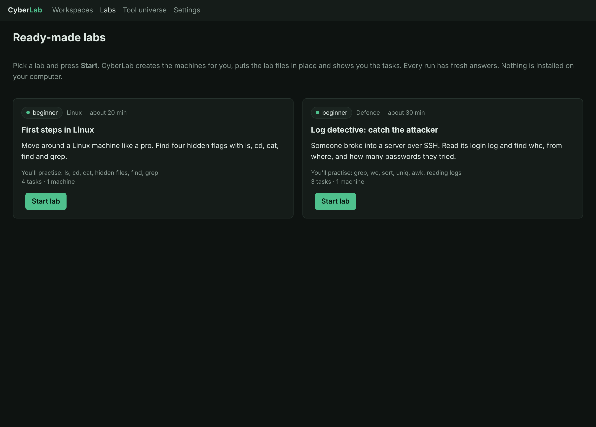

# Ready-made labs



Open **Labs** in the top menu, pick a lab and press **Start lab**. CyberLab:

1. creates a workspace named after the lab,
2. starts the lab's machines (the first time takes a minute or two while the machine is prepared),
3. puts the lab's files inside them, and
4. opens the **Lab** tab with the tasks.

Open the terminal from the Lab tab, solve a task, paste the answer and press **Check**. Stuck?
**Show a hint** reveals one hint at a time. Every run makes **fresh answers**, so they can't be
copied from someone else (or from this repository). When you're done, destroy the machines
in **Environments** to free your resources, or delete the workspace.


## Labs included
| Lab | Level | You practise |
|---|---|---|
| First steps in Linux | beginner | `ls`, `cd`, `cat`, hidden files, `find`, `grep` |
| Log detective: catch the attacker | beginner | reading an SSH log with `grep`, `awk`, `sort`, `uniq`, `wc` |

Labs never reach the internet: these two have no network at all. Lab logs use only
addresses reserved for documentation (RFC 5737), never a real computer.

## Write your own lab
A lab is one YAML file in `registry/labs/<id>.yaml`. CyberLab checks every lab when it
starts and refuses broken ones with a clear message.

```yaml
id: my-first-lab                 # must match the file name
title: My first lab
level: beginner                  # beginner | intermediate | advanced
minutes: 15
topic: linux                     # linux | networking | web | forensics | blue-team | crypto
summary: One sentence shown on the card.
skills: [cat]
introduction: |
  What the learner should know before starting.
spec:                            # the machines: the normal Universe Manifest "spec"
  environments:
    - name: student
      baseImage: ubuntu-24-04
      resources: {cpu: 0.5, memoryMiB: 512, storageGiB: 2}
      network: {mode: isolated}  # labs may use only "isolated" or "lab"
setup:                           # files put into /workspace when the lab starts
  - environment: student
    path: note.txt
    content: "The flag is {{flag:read-it}}"   # replaced by a fresh random flag
tasks:
  - id: read-it
    title: Read the note
    text: Print note.txt with `cat note.txt`.
    hints: ["`cat` prints a file."]
```

Instead of `content`, a setup file can use a built-in **generator** that makes fresh
content for every run:

| Generator | Makes | Answers it provides |
|---|---|---|
| `maze` | a folder of folders with one `treasure.txt` (needs `flagTask`) | the flag |
| `app-log` | a 3000-line application log with one flag line (needs `flagTask`) | the flag |
| `auth-log` | an SSH log with one brute-force attacker | `attacker-ip`, `attacker-user`, `failed-count` |

A task's `answer` is `flag` (the default) or the name of a generated answer, for example
`answer: attacker-ip`. Generators are Python functions in
`backend/src/cyberlab/labs/generators.py`; lab files can never contain code.

Check your lab with the tests: `cd backend && pytest tests/test_labs.py`.

## Coming next
Target machines with intentionally vulnerable services on a private lab network, for
labs such as *Scan a network with nmap* and *Find the secret in a web app*
(see `docs/plans/ready-made-labs.md`).
